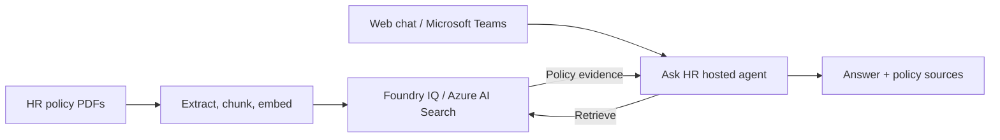

# Ask HR

An HR policy assistant for the web and Microsoft Teams, built with
**Microsoft Foundry**. Ask questions about policies for India, Finland, and
Hong Kong, retrieve the relevant local and Global guidance, and open the
supporting PDF pages alongside the answer.

[Try the public demo](https://ca-ask-hr-web.braveforest-aa9da5f8.francecentral.azurecontainerapps.io)
| [Ingestion and evaluation guide](SHARING.md)
| [Hosted agent setup](ask-hr/README.md)
| [Web app setup](apps/ask-hr-web/README.md)

> **Demo only.** The policies are fictional, not authoritative HR advice.
> Do not enter personal or confidential information in the public demo.

## Try it

Open the demo and ask:

> For an employee in Hong Kong, what is the annual leave entitlement?

Answers stream into the chat. Source cards open the cited PDF pages with
highlighted passages.

The public deployment runs the
[`feat/ask-hr-public-demo` branch](https://github.com/zhenbzha/hr-demo/tree/feat/ask-hr-public-demo)
without sign-in. **`main` retains the authenticated web and Teams flows.**

## How it works



- **Ingest:** Document Intelligence extracts the PDFs. The pipeline preserves
  page references, creates embeddings, updates Search, and stores versioned PDFs
  and highlighting annotations in ADLS Gen2.
- **Answer:** One hosted agent serves the web through Responses and Teams through
  Activity. Both use the same HR pipeline: identify the region, retrieve local
  and Global evidence, and generate an answer with selected policy sources.
- **Evaluate:** A separate workflow scores employee-facing answers against
  PDF-backed references and checks their citations.

## Ingest documents and evaluate answers

These workflows run independently of the web application. Evaluation requires
an already deployed, compatible Ask HR Responses endpoint.

Use **Python 3.12+, uv, and Azure CLI** for these repository-root commands.
First configure Azure access and service endpoints using the
[ingestion and evaluation guide](SHARING.md#dependencies-and-access).

```powershell
uv sync --locked --extra evaluation
```

### Ingest policy PDFs

Place PDFs under `data\global`, `data\india`, `data\finland`, or `data\hongkong`.
Ingestion processes new or changed PDFs and synchronizes their Search records.
Use a **dedicated demo index**: incompatible schema changes can rebuild it.
Do not point this workflow at a serving production index.

```powershell
# Inspect the proposed schema locally; no Azure calls.
uv run --locked python .\scripts\index_hr_documents.py --schema-only

# Ingest the configured policy corpus.
uv run --locked python .\scripts\index_hr_documents.py
```

See [configuration](SHARING.md#ingestion-configuration-and-source-integrity)
and [incremental updates](SHARING.md#incremental-updates-and-artifact-versions)
for the full workflow.

### Evaluate the hosted agent

Configure the [evaluation environment](SHARING.md#manual-foundry-evaluation),
then run:

```powershell
uv run --locked --extra evaluation python .\scripts\run_foundry_evaluation.py
```

Every case receives a native Foundry HR-rubric assessment and deterministic
citation checks. Policy-answer cases also receive Response Completeness checks
against PDF-derived reference answers.

The references require HR review before acceptance use; this is a limited demo
suite, not comprehensive policy validation. Read the
[evaluation limitations](SHARING.md#evaluation-limitations). Optional
[judge checks](SHARING.md#frozen-judge-spot-check) assess the grader separately.

## Explore the project

- [Hosted agent and Teams](ask-hr/README.md): shared pipeline, authentication,
  deployment, and channel setup.
- [Web application](apps/ask-hr-web/README.md): Next.js chat, local development,
  and container deployment.
- [Microsoft 365 Responses adapter](apps/ask-hr-m365-adapter/README.md):
  a separate Teams bridge, distinct from the agent's direct Activity integration.
- [Policy PDFs](data): fictional Global and regional source documents.
- [Scripts](scripts): ingestion, retrieval checks, and evaluation entry points.
- [Tests](tests): regression checks, evaluation cases, and PDF-backed references.
- [Infrastructure](infra): Azure resources, managed identities, and RBAC in Bicep.

## Deployment notes

<details>
<summary>Azure setup, package feeds, and repository conventions</summary>

The root [azure.yaml](azure.yaml) manages infrastructure; the nested
[ask-hr/azure.yaml](ask-hr/azure.yaml) manages the hosted agent. Follow the
existing deployment order and the component setup guides above.
The root post-provision hook synchronizes model bindings into the nested
agent environment (`ASK_HR_AGENT_ENV_NAME`, default `ask-hr-dev`).

For hosted-agent deployment, run from `ask-hr`:

```powershell
$env:AZURE_DEV_USER_AGENT = "microsoft_foundry_skill"
azd deploy ask-hr --no-prompt
```

Set `AZURE_DEV_USER_AGENT` in the shell only, not in committed configuration.
The agent's `.agentignore` controls its code bundle; `.azdignore` is not its
packaging filter.

**Python packages.** [uv.toml](uv.toml) configures Microsoft Central Feed Services
and system certificate trust. Do not add public PyPI as a fallback. For direct
pip commands, set:

```powershell
$env:PIP_INDEX_URL = "https://packagefeedproxy.microsoft.io/pypi/simple"
```

**Storage networking.** The demo Storage account uses the account-scoped
`SecurityControl=Ignore` policy exception to retain public networking. Keep it
on that account, not the resource group. Data access still requires Microsoft
Entra authorization; anonymous blob access and Shared Key access are disabled.

**Storage lock.** The `keep-demo-storage-public` ReadOnly management lock is
applied after role assignments. Remove it before reprovisioning or changing
account configuration or account-scoped RBAC. Successful provisioning restores
it; restore it manually if provisioning fails. Authenticated document reads
and ingestion uploads remain available while the lock is in place.

**Local state.** Keep `.azure`, credentials, generated planning folders, caches,
and evaluation outputs out of Git. Historical run artifacts are local and are
not included in a fresh checkout.

</details>
